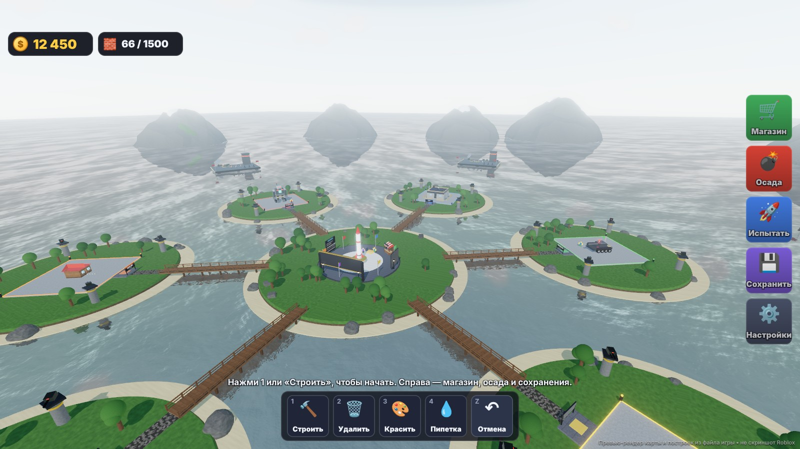
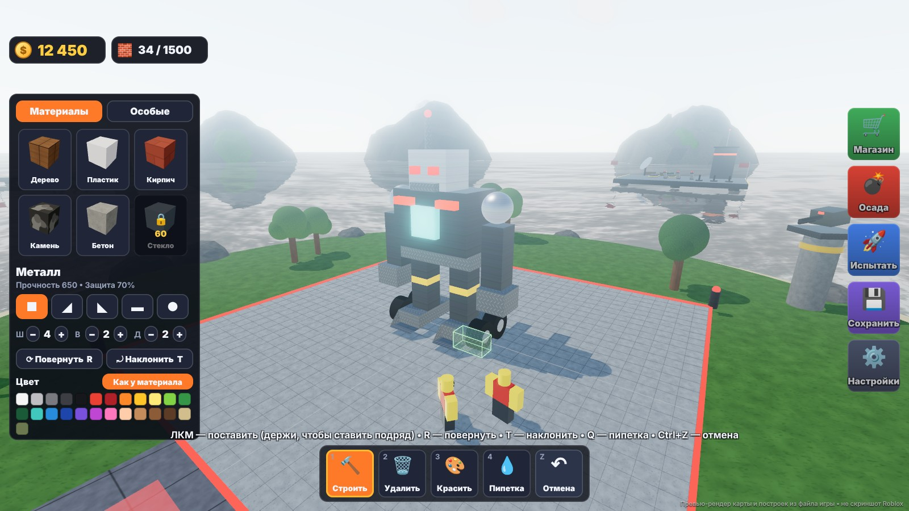
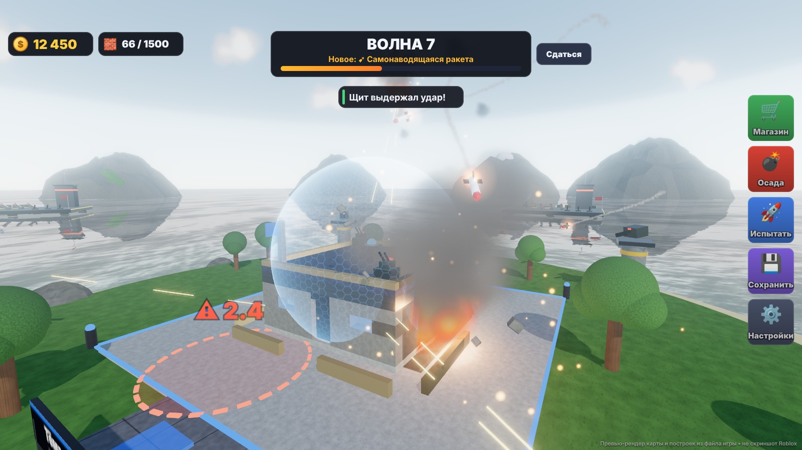
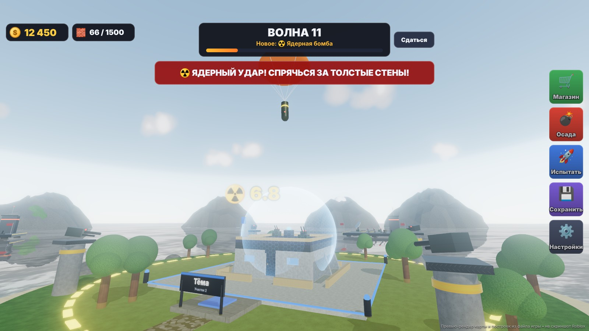
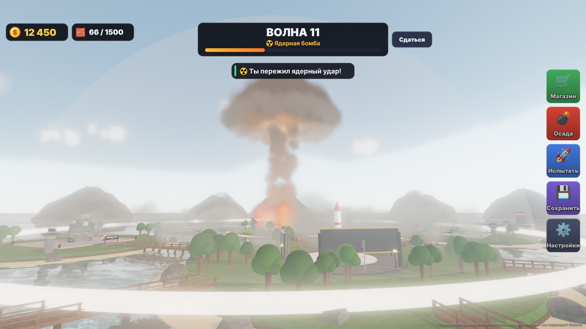
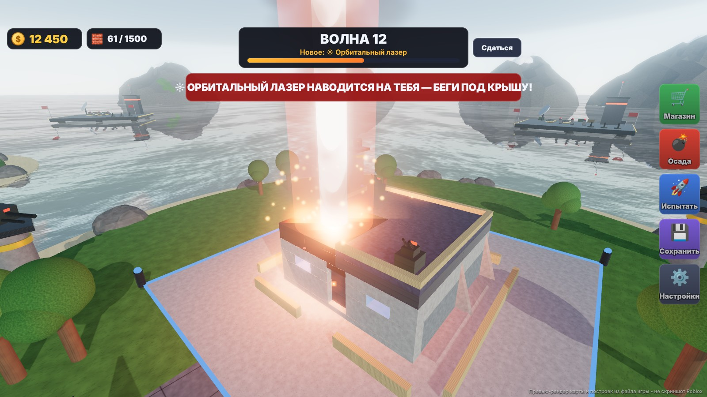
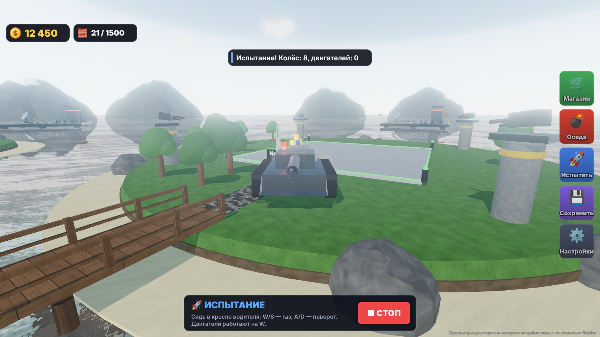
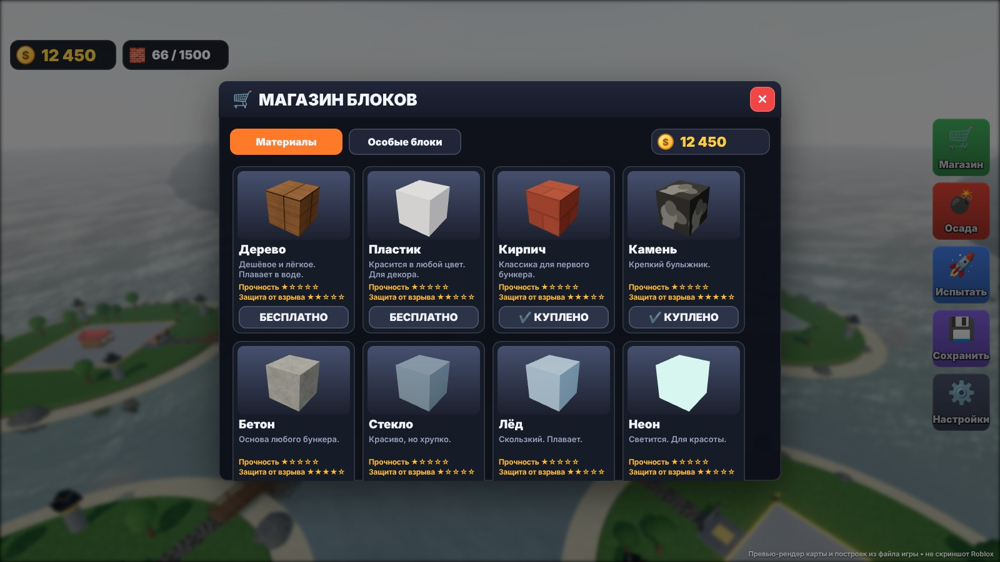
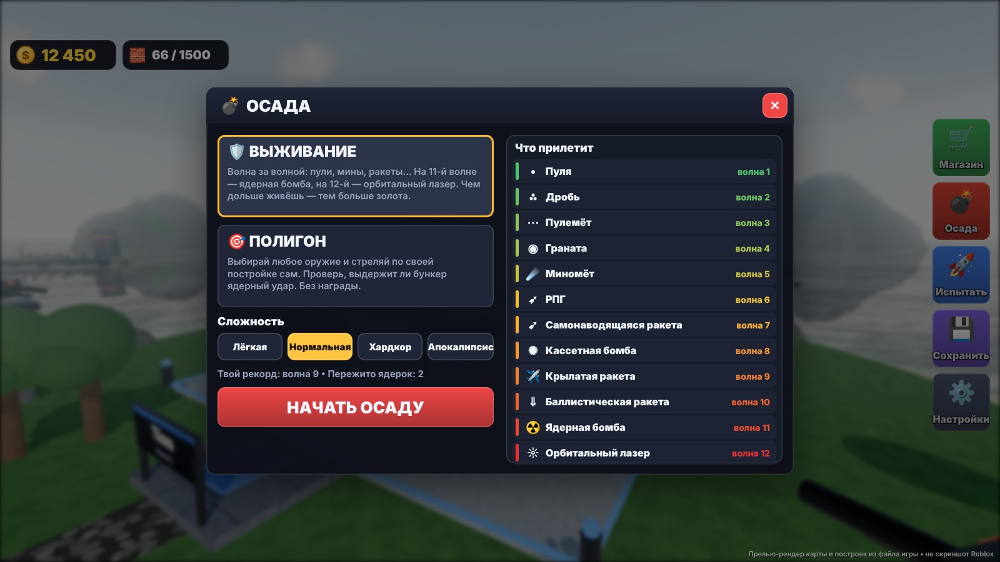
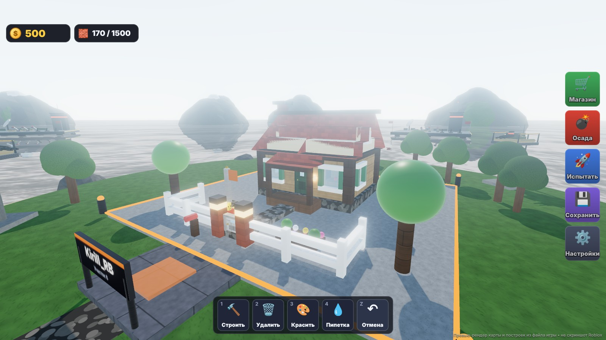

# BUILD & SURVIVE — «Построй что угодно и выживи» для Roblox

Игра в духе **Build a Boat for Treasure**, только строить можно что угодно: бункеры, базы, роботов, танки, машины, катера.
Главный режим — **ракетная осада**: по твоей постройке стреляют волнами. Сначала пули, потом гранаты, мины, ракеты,
а в конце — **ядерная бомба** и **орбитальный лазер из космоса**.

Файл для Roblox Studio: **`BuildAndSurvive.rbxlx`**.

> ⚠️ Скриншоты ниже — это **превью-рендер**, а не снимки из Roblox Studio. Studio здесь не запускается (облачная Linux-машина),
> поэтому карта и постройки отрисованы на three.js из тех же данных, из которых собран файл игры. Интерфейс — точная HTML-копия
> игровых панелей. В самом Roblox картинка будет немного другой: другие текстуры материалов, другое небо и облака.

| | |
|---|---|
|  |  |
|  |  |
|  |  |
|  |  |
|  |  |

## Как открыть
1. Roblox Studio → **File → Open from File** → `BuildAndSurvive.rbxlx`.
2. Нажми **Play** (F5). При первом запуске сервер за несколько секунд строит рельеф: море, острова, пляжи, горы на горизонте.
3. Чтобы рельеф был виден и в режиме редактирования, один раз выполни в **View → Command Bar**:
   ```lua
   require(game.ServerScriptService.Server.TerrainGen).build(true)
   ```
   и сохрани место (Ctrl+S).
4. Чтобы сохранялись золото, покупки и постройки:
   1. **File → Publish to Roblox**;
   2. **Game Settings → Security → Enable Studio Access to API Services**.
5. **Game Settings → Places → Max Players = 6** — на карте 6 участков.

## Как играть
- Ты появляешься на своём участке (у каждого свой цвет, как в Build a Boat). Новичку сразу дают деревянный домик.
- **Строй** блоками из панели слева: 18 материалов × 5 форм (блок, клин, угол, цилиндр, шар) и 12 особых блоков.
- **Осада** (красная кнопка справа):
  - **Выживание** — волны 1–12 открывают новое оружие, дальше бесконечные волны с ядерками и лазерами.
    За каждую волну — золото. Есть 4 сложности: лёгкая, нормальная, хардкор, апокалипсис.
  - **Полигон** — стреляешь сам любым оружием по своей постройке (в себя или кликом по точке).
- После осады постройка **восстанавливается сама**.
- **Испытать** — постройка оживает: колёса крутятся, двигатели толкают, шары поднимают, лёгкие блоки плавают.
  Садись в «Кресло водителя» и жми WASD.
- **Сохранить** — 3 слота и 4 готовых примера: домик, бункер «Судный день», боевой робот, танк.
- **Магазин** — за золото открываются прочные материалы и особые блоки (у прилавка в лобби тоже можно нажать E).

### Управление
| Действие | Клавиши |
|---|---|
| Инструменты: строить / удалить / красить / пипетка | 1 / 2 / 3 / 4 |
| Поставить блок (держи — ставит подряд) | ЛКМ |
| Повернуть / наклонить / повернуть вбок | R / T / Shift+R |
| Скопировать блок под курсором | Q |
| Отменить действие | Ctrl+Z |
| Закрыть окно / снять инструмент | Esc |

На телефоне: касание — поставить блок, кнопки на экране — всё остальное.

## Что прилетает (12 видов оружия)
| Волна | Оружие | Как защититься |
|---|---|---|
| 1 | Пуля — очереди с вышек вокруг участка | любые стены |
| 2 | Дробь — 9 дробинок веером | стены, мешки с песком |
| 3 | Пулемёт — длинная очередь | мешки с песком (пули почти не берут) |
| 4 | Граната — по дуге | толстые стены |
| 5 | Миномёт — почти отвесно, красный круг на земле | **крыша** |
| 6 | РПГ — с дымным следом | бетон, металл, турель ПВО |
| 7 | Самонаводящаяся ракета — летит за тобой | прятаться за стенами, ПВО |
| 8 | Кассетная бомба — бомбардировщик, 12 бомбочек | крыша, щит |
| 9 | Крылатая ракета — низко над водой | толстая броня |
| 10 | Баллистическая ракета — из стратосферы | обсидиан, титан |
| 11 | **Ядерная бомба** — на парашюте, сирена, гриб, ударная волна | несколько слоёв свинца или бетона |
| 12 | **Орбитальный лазер** — прожигает крышу слой за слоем и ползёт за тобой | золото (отражает), много слоёв крыши |

Стены и правда защищают: каждый блок между взрывом и тобой гасит часть урона — тем больше, чем он прочнее и толще.
Турель ПВО сбивает ракеты на подлёте, генератор щита ставит купол на 2500 урона, аптечка лечит, энергокристалл сам чинится,
динамит взрывается цепочкой.

## Материалы
| Материал | Цена | Прочность (2×2×2) | Особенность |
|---|---|---|---|
| Дерево | бесплатно | 100 | плавает |
| Пластик | бесплатно | 70 | для декора |
| Кирпич | 120 | 220 | |
| Камень | 250 | 320 | |
| Бетон | 400 | 420 | хорошая защита |
| Стекло | 60 | 50 | хрупкое |
| Лёд | 150 | 90 | плавает |
| Неон | 200 | 80 | светится |
| Мешки с песком | 300 | 260 | пули почти не берут |
| Резина | 450 | 240 | гасит взрывы |
| Металл | 800 | 650 | |
| Бронестекло | 1 800 | 700 | прозрачное и пулестойкое |
| Броня | 1 500 | 1 000 | |
| Свинец | 2 600 | 800 | лучшая защита от радиации |
| Титан | 4 000 | 1 800 | |
| Обсидиан | 7 000 | 2 800 | почти неразрушим |
| Золото | 10 000 | 500 | отражает лазер |
| Энергокристалл | 12 000 | 1 500 | сам восстанавливается |

Особые блоки: сиденье, кресло водителя, колесо, реактивный двигатель, воздушный шар, дверь, лампа, флаг,
динамит, аптечка, турель ПВО, генератор щита.

## Что сделано для максимального качества картинки
Настройки подобраны по официальному уроку Roblox «Enhance outdoor environments» и советам с DevForum:
- **Освещение:** `LightingStyle = Realistic` (бывший Future), `PrioritizeLightingQuality`, мягкие тени,
  `EnvironmentDiffuseScale` и `EnvironmentSpecularScale = 1` (металл отражает небо).
- **Небо:** `Atmosphere` (дымка и блики солнца), объёмные облака `Clouds`, `SunRays`, `Bloom` для неона и взрывов,
  `ColorCorrection` (чуть больше контраста и насыщенности), лёгкий `DepthOfField` для дали.
- **Вода:** настоящая вода Terrain с отражениями и волнами. Высокая анимированная трава (`Terrain.Decoration`) выключена — она закрывала постройки.
- **Эффекты:** огонь, дым, искры и ударные волны на встроенных текстурах Roblox; динамический свет от взрывов с тенями;
  тряска камеры; звук далёких взрывов приходит с задержкой (как в жизни).
- **Ядерный взрыв:** ослепительная вспышка, огненный шар, гриб из сотен частиц, кольцо ударной волны, оранжевое небо,
  пепел вокруг камеры, гул на 25 секунд.
- **Настройки графики** в игре: «Ультра», «Средняя», «Низкая» — для слабых телефонов.

## Звуки
ID взяты из официальных библиотек Creator Store, которые можно использовать в любой игре:
**Pro Sound Effects** (звуки с пометкой «(SFX)») и музыка **APM**. Полный список с названиями — в
`src/ReplicatedStorage/Shared/Sounds.lua`. У каждого звука есть запасные ID и встроенный звук Roblox:
если какой-то ID не загрузится, игра сама возьмёт следующий.

| Звук | ID | Название в Creator Store |
|---|---|---|
| Взрыв средний | 9120705982 | Whoosh Explosion 1 (SFX) |
| Взрыв большой / ядерный | 9114363548 | Explosion Soft Crack 11 (SFX) |
| Гул после ядерки | 9114224217 | Earthquake Explosion 3 (SFX) |
| Граната, маленький взрыв | 9117895914 | Pressure Blast 2 (SFX) |
| Запуск ракеты | 12222132 | Shoulder fired rocket.wav (@Roblox) |
| Полёт ракеты | 9125742111 | Plasma Trails Constant Airy Whooshing (SFX) |
| Пулемёт | 9116338227 | Machine Gun 4 (SFX) |
| Выстрел | 9113181642 | Assault Rifle 21 (SFX) |
| Свист пули | 9113634444 | Bullet Whiz 2 (SFX) |
| Сирена воздушной тревоги | 9113073742 | Air Raid Siren Old Fashioned 1 (SFX) |
| Зарядка лазера | 9125973257 | Spaceship Blast High Pitch Energy Charge Up (SFX) |
| Гул лазера | 9116386540 | Magic Force Field Constant 2 (SFX) |
| Выстрел лазера | 9116231442 | Laser Cannon 207 (SFX) |
| Обломки | 9125392715 | Big Rocks Drop Interior Muffled Some Debris (SFX) |
| Бомбардировщик | 9120054806 | Time Travel Approach In Fast Pass Fly By 3 (SFX) |
| Музыка: стройка | 1843404009, 9042666762, 9044014229 | Happy Song, Chillin at Home, Stay Upbeat B (APM) |
| Музыка: осада | 9038254566, 1839912010, 1845805363 | Metal Storm Breaks, Running Chase b, Fire Fight A (APM) |

Проверить звуки на слух отсюда было нельзя: сайты Roblox закрыты в моей среде. Если что-то звучит не так —
замени ID первым в списке в `Sounds.lua`.

## Для разработчиков
Код — в `src/` (Luau), файл места собирается [Rojo](https://rojo.space):
```
sh build.sh            # карта + примеры + сборка BuildAndSurvive.rbxlx
```
- `tools/gen_map.py` — карта: лобби, 6 участков, мосты, вражеские базы, рельеф → `src/Workspace/*.model.json`, `MapLayout.lua`.
- `tools/gen_examples.py` — примеры построек → `Examples.lua`.
- `src/ServerScriptService/Server/` — сервер: `Building` (строительство с проверками), `Siege` (волны), `Attacks` (как стреляет
  каждое оружие), `Projectiles` (полёт снарядов), `Damage` (урон, укрытия, обломки), `Specials` (щиты, ПВО, двери, аптечки),
  `Launch` (испытания), `Data` (сохранения), `Shop`, `Plots`, `TerrainGen`, `Lobby`.
- `src/ReplicatedStorage/Client/` — клиент: `BuildController`, `Projectiles` (модели снарядов), `Fx` (взрывы, ядерка, лазер),
  `SoundPlayer`, `CameraShake`, `World`, папка `UI`.

Проверки (запускались перед сборкой):
- `tools/check.sh` — типы Luau против определений Roblox API (luau-lsp): 0 ошибок;
- `python3 tools/check_props.py API-Dump.json` — все 1184 имени свойств в таблицах интерфейса и эффектов существуют в API;
- `lune run tools/test.luau` — 4109 проверок: сетка и повороты, сохранения, прочность, баллистика, сборка каждого блока
  из настоящих классов Roblox, примеры построек (в сетке, без пересечений, колёса прикреплены).
- `tools/preview/` — превью-рендер для скриншотов (three.js + Playwright).

Это фан-проект для обучения. Если будешь публиковать — дай игре своё название и обложку.
