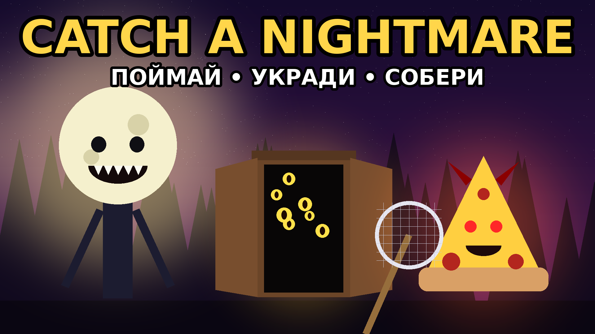

# Catch a Nightmare (Roblox)

**Днём строишь базу, ночью ловишь кошмаров и крадёшь их у других.**
Монстры сидят в клетках на твоей базе и каждую секунду приносят «Страх» — даже пока тебя нет в игре.

## Как открыть
1. Скачай `CatchNightmare.rbxlx` и открой в Roblox Studio: **File → Open from File**.
2. Нажми **Play** (F5). Ты появишься на своей базе, а перед ней будет ждать первый монстр.
3. Чтобы сохранялся прогресс:
   1. **File → Publish to Roblox**.
   2. **Game Settings → Security → Enable Studio Access to API Services**.
4. **Game Settings → Places → Max Players = 8**: баз ровно 8. Девятому игроку не хватит базы, и его попросит зайти на другой сервер.

Чтобы проверить игру вдвоём, открой **Test → Clients and Servers → 2 Players → Start**.

## Как играть
- **Поймай монстра.** Подойди к нему и держи **E**. Чем реже монстр, тем дольше держать.
- **Отнеси на базу.** Пока монстр у тебя на голове, ты идёшь медленнее. Дошёл до своей базы — монстр сам садится в свободную клетку.
- **Монстр приносит Страх** каждую секунду. Пока тебя нет в игре, база тоже зарабатывает (половину дохода, до 3 часов).
- **Кради.** Зайди на чужую базу и держи **E** у клетки («Украсть»). Потом беги к себе.
- **Отбирай.** Подбеги к игроку, который несёт монстра, и держи **F** («Отобрать»). Так можно вернуть украденное.
- **Запирай базу.** Нажми зелёную кнопку у входа: дверь закроется на 60 секунд. Ты сам проходишь сквозь неё, а чужие нет.
- **День и ночь.** Днём (4 мин) появляются только обычные, необычные и редкие монстры. Ночью (3 мин) монстров много, выходят эпические, легендарные, мифические и секретные. Ещё ночью монстры могут **напугать**: скример, оглушение, и добыча падает с головы.
- **События ночи:**
  - **Кровавая луна** (18%): удача ×3, кровавые мутации;
  - **Глитч-ночь** (10%): глитч-мутации в 25 раз чаще;
  - **Туман** (15%): монстров больше, но видно хуже.
- **Мутации.** Золотой монстр даёт ×2 дохода, Кровавый ×3, Глитч ×5.
- **Лавка Ловца** у костра в центре (или кнопка «🛒 Лавка»):
  - **сети** открывают более редких монстров (сеть 5 — мифических и секретных);
  - **приманки** призывают монстра с повышенной удачей. Запас обновляется каждые 5 минут, редкие приманки появляются не всегда;
  - **клетки**: больше мест на базе. Клетку можно купить и прямо на базе, у замка на пустом месте.
- **Продажа.** Держи **E** у своей клетки, чтобы продать монстра за 40 секунд его дохода.

### Монстры
| Редкость | Монстры | Шанс | Сеть |
|---|---|---|---|
| Обычный | Тапок-Кусака, Пыльный Бубу | основа | 1 |
| Необычный | Холодильник Валера, Носок-Призрак | 1 к 4 | 1 |
| Редкий | Шкаф с Глазами, Лампа-Шептун | 1 к 12 | 2 |
| Эпический | Бабушка Wi-Fi, Матрёшка-Паук | 1 к 50 | 3 |
| Легендарный | Кот 404, Пицца-Демон | 1 к 300 | 4 |
| Мифический | Луноголовый | 1 к 3 000 | 5 |
| Секретный | Тот-Кого-Нет | 1 к 60 000 | 5 |

Шанс считается так: от самой редкой редкости вниз, шанс каждой = удача / N. Удачу повышают приманки, Кровавая луна и «Удача ×2» за Robux.
Когда кто-то ловит легендарного или более редкого монстра (или такой появляется в лесу), весь сервер видит объявление.

### Управление
| Действие | Клавиша |
|---|---|
| Поймать / украсть / продать / купить клетку / запереть | держать **E** |
| Отобрать монстра у игрока | держать **F** |
| Лавка | кнопка «🛒 Лавка» или прилавок у костра |
| Приманка | кнопка с приманкой внизу экрана (только в лесу) |

На телефоне все подсказки нажимаются пальцем, кнопки крупные.

## Настройка
Все цифры лежат в `src/ReplicatedStorage/Shared/Config.lua`:
- время дня и ночи;
- шансы и доход монстров;
- цены сетей, клеток и приманок;
- события ночи;
- звуки.

### Robux
1. Создай товары в **Creator Hub → твоя игра → Monetization**:
   - **Developer Product** «Удача ×2 для всего сервера»;
   - **Passes** «×2 Страха» и «+2 клетки».
2. Впиши их ID в `Config.Products.ServerLuck.id`, `Config.Passes.DoubleFear.id` и `Config.Passes.ExtraCages.id`.

Пока ID равен 0, кнопка покупки только пишет «Товар ещё не настроен».

### Админ-команды
В Studio админ-панель («⚙ Админ» справа) видят все. В опубликованной игре её видят владелец игры и UserId из `Config.Admins`.
Кнопки делают то же, что команды в чате:
- `/day`, `/night` — день, ночь;
- `/bloodmoon`, `/glitch`, `/fog` — события ночи;
- `/spawn legendary` — монстр нужной редкости;
- `/fear 10000` — добавить Страх;
- `/luck` — удача ×2;
- `/restock` — обновить лавку.

Ими удобно устраивать «админ-ивенты»: зайти в игру и включить Кровавую луну, пока на сервере много людей.

## Перед публикацией
- Иконка и обложка лежат в `assets/branding/`: `icon_512.png` и `thumbnail_1920x1080.png`. Перерисовать их: `python3 tools/make_icon.py`. Скриншоты из самой игры потом сработают ещё лучше.
- Название на английском: **Catch a Nightmare** (так игру находят по поиску во всём мире). Обновления можно отмечать в названии: `[🌕 BLOOD MOON] Catch a Nightmare`.
- Тексты в игре пока на русском. Английский перевод — следующий шаг.

## Разработка
- Код лежит в `src/`. Сборка: `python3 build.py` → `CatchNightmare.rbxlx`.
- Проверка синтаксиса и случайных глобальных переменных: `sh tools/check.sh` (нужен `npm install luaparse`).
- **Песочница без Studio:** `python3 tools/run_mock.py` (нужен `pip install lupa`). Игра запускается в моке Roblox (`tools/mock/`), сценарий `tools/scenario.lua` проходит основной цикл двумя игроками:
  - поймать, отнести, украсть, отобрать;
  - замок базы, лавка, приманки, Кровавая луна;
  - смерть с монстром, покупка за Robux, сохранение и перезаход;
  - кнопки интерфейса.

  В конце печатаются ошибки, предупреждения и подозрительные места (несуществующие свойства, неверные типы).

### Устройство
| Файл | Что делает |
|---|---|
| `Shared/Config.lua` | все настройки |
| `Shared/Util.lua` | формат чисел, ролл редкости и мутаций |
| `Shared/Monsters.lua` | модели монстров из деталей и подписи |
| `Shared/Build.lua`, `Shared/Net.lua` | постройка деталей, удалённые события |
| `Server/World.lua` | карта: лес, тропы с фонарями, костёр, лавка, 8 баз |
| `Server/Data.lua` | сохранение (DataStore), таблица лидеров |
| `Server/Cycle.lua` | день и ночь, события, удача сервера |
| `Server/Bases.lua` | базы, клетки, доход, замок, кража, продажа |
| `Server/Carry.lua` | переноска на голове, «Отобрать», доставка |
| `Server/Wild.lua` | дикие монстры, ловля, испуг, приманки |
| `Server/Shop.lua` | лавка и её запас |
| `Server/Monetize.lua` | покупки за Robux |
| `Server/Admin.lua` | админ-команды |
| `Client/UI.lua` | интерфейс |
| `Client/Visuals.lua` | свет дня и ночи, подсказки «только для своих», дверь своей базы, покачивание монстров |

Монстры, названия и картинки придуманы для этой игры.
