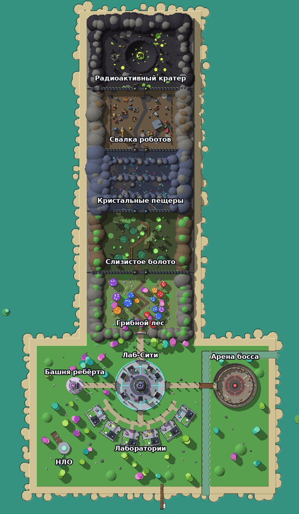

# Mutant Lab Simulator — карта (этап 1)

Симулятор безумного учёного для Roblox. Игрок собирает странные ингредиенты, смешивает их в котле
и выращивает мутантов-питомцев. Сейчас готова **только карта**, логику игры добавим следующим этапом.



## Как открыть
1. Roblox Studio → **File → Open from File** → `MutantLab.rbxlx`.
2. Нажми **Play** (F5). Сервер построит карту за пару секунд, и ты появишься в центре площади.

Файл собирается из папки `src/` командой `python3 build.py`.

### Чтобы видеть карту в Studio без запуска игры
Карта строится скриптом при запуске. Её можно собрать заранее, тогда она останется в месте:
1. **View → Command Bar**.
2. Вставь строку и нажми Enter:
   ```lua
   require(game.ServerScriptService.Map).build()
   ```
3. Карта и рельеф появятся прямо в редакторе. Сохрани: **File → Save to File**.

Если карта уже сохранена в месте, при запуске игра не строит её заново. Чтобы пересобрать после
изменений в коде, ещё раз выполни ту же строку: старая карта и рельеф сотрутся сами.

## Что на карте
Остров посреди бирюзового моря. Север — зоны, юг — лаборатории, восток — арена, запад — башня.

| Место | Что там |
|---|---|
| **Лаб-Сити** (центр) | Великий Мутатор: котёл под стеклянным куполом, катушки Теслы с молниями, парящее ядро. Точка появления. 6 магазинов: Инкубатор, Улучшения, Рюкзаки, Книга мутантов, Награда дня, Зелья. 2 доски лидеров. 4 арки-выхода. |
| **Лаборатории** (юг) | 6 участков игроков. На каждом: здание лаборатории, загон для мутантов, свой котёл, круг «занять лабораторию», табличка владельца. |
| **1. Грибной лес** (бесплатно) | Гигантские грибы (на шляпки можно запрыгнуть), тропа, кольцо фей, брёвна, светлячки. |
| **2. Слизистое болото** (1 000) | Топь, пруды с кувшинками, светящиеся лужи слизи, настил через болото, хижина ведьмы на сваях, туман. |
| **3. Кристальные пещеры** (15 000) | Каменные арки над головой, светящиеся кристаллы, парящее «Сердце пещер», шахта с вагонеткой, озерцо. |
| **4. Свалка роботов** (200 000) | Горы металлолома, сломанные роботы, гигантская голова робота, кран с магнитом, старые машины. |
| **5. Радиоактивный кратер** (3 000 000) | Воронка со светящимся озером и метеоритом, гейзеры, бочки с отходами, станция наблюдения. |
| **Арена босса** (восток, за рекой) | Мост, колизей с трибунами, кольцо рун, жаровни, табло «Босс появится через…». |
| **Башня ребёрта** (запад) | Высокая башня с парящей сферой и портал ребёрта. |
| **Остров** | Разбившаяся летающая тарелка, пирс с лодкой, парящие островки в небе, деревья и цветы. |

Между зонами стоят стены с воротами и силовым барьером. Над воротами написана цена открытия.
Зоны поднимаются ступенями: каждая следующая на 6 стадов выше предыдущей.

**Живая карта** (скрипт `MapFx` на клиенте):
- голограммы, кристаллы и радар вращаются, лодка качается на волнах;
- неон пульсирует, у катушек Теслы сверкают молнии;
- в каждой зоне своя дымка и свой оттенок, при входе в зону всплывает её название.

## Заготовки для логики
Карта уже размечена, чтобы следующий этап (сбор, смешивание, питомцы) нашёл всё по атрибутам:

| Что | Где | Атрибуты |
|---|---|---|
| Точки появления ингредиентов (по 45 на зону) | `Map.Zones.<Зона>.Spawns` | `Zone`, `Index` |
| Барьеры зон | `Map.Zones.<Зона>.Gate_<Зона>.Barrier`, метка `ZoneBarrier` | `Zone`, `Price` |
| Области зон | `Map.Zones.<Зона>.Bounds` | `Zone`, `Level`, `Price`, `Index` |
| Котёл на площади, магазины | `MixerStation`, `Shop_*` → `Station` | `Station` |
| Участки игроков | `Map.Plots.Plot1..6` | `PlotId`, `Owner`; внутри `ClaimPad`, `PlotSpawn`, `PlotMixer`, `PetArea`, `OwnerSign` |
| Доски лидеров | `Leaderboard_Coins`, `Leaderboard_Rebirths` | `Stat`; строки `Row1..Row10` |
| Арена | `BossSpawn`, `BossZone`, табло `TimerBoard` | `Role` |
| Ребёрт | `RebirthPortal` | `Station = "Rebirth"` |

Координаты, размеры зон, цены и атмосфера собраны в одном месте: `src/ReplicatedStorage/Shared/MapData.lua`.

## Устройство кода
- `src/ServerScriptService/Main.server.lua`: точка входа. Строит карту и только потом пускает игроков.
- `src/ServerScriptService/Map/`:
  - `Terrain` — океан, остров, обрывы, хребты, река, подъёмы между зонами;
  - `Sky` — свет, небо, облака;
  - `Hub`, `Plots`, `BossArena`, `RebirthTower`, `Island` — постройки;
  - `Zones` — стены, ворота и границы; по одному файлу на зону в `Zones/`;
  - `Props` — общие детали: фонари, заборы, вывески, деревья, кристаллы, бочки.
- `src/ReplicatedStorage/Shared/`: `MapData` (описание карты), `Build` (помощники постройки), `Rng`
  (свой генератор случайных чисел, чтобы карта всегда строилась одинаково).
- `src/StarterPlayer/StarterPlayerScripts/MapFx.client.lua`: анимации и атмосфера зон.

## Проверка без Studio
- `python3 tools/run_map.py` — запускает весь код в песочнице с моком Roblox API (нужен `pip install lupa`):
  - находит ошибки и опечатки в свойствах;
  - считает детали и точки появления;
  - проходит персонажем по всем зонам.
- `python3 tools/run_map.py --json map.json` и `python3 tools/preview.py map.json out.png --labels` — рисуют карту
  сверху (нужны `numpy`, `pillow`). Крупный план: `--scale 3 --crop x0 z0 x1 z1`.
- `sh tools/check.sh` — синтаксис и случайные глобальные переменные (нужен `npm i -g luaparse`).

Размер карты: около 9 000 деталей и 750 операций рельефа.
