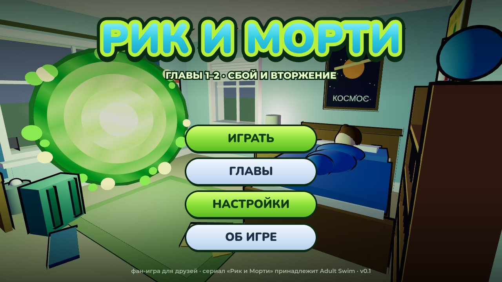
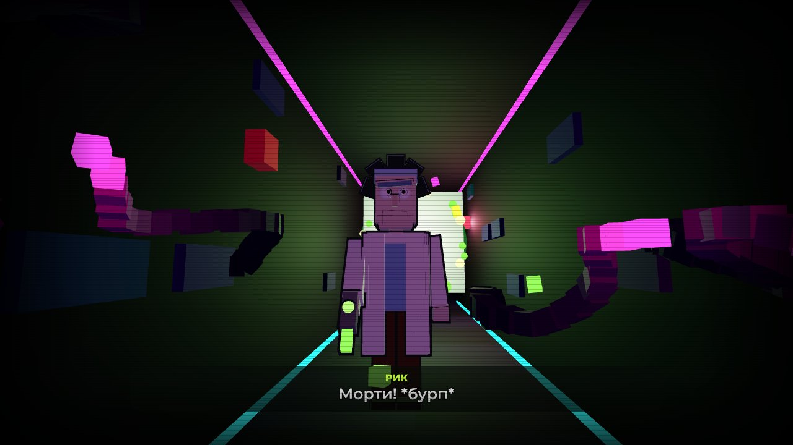
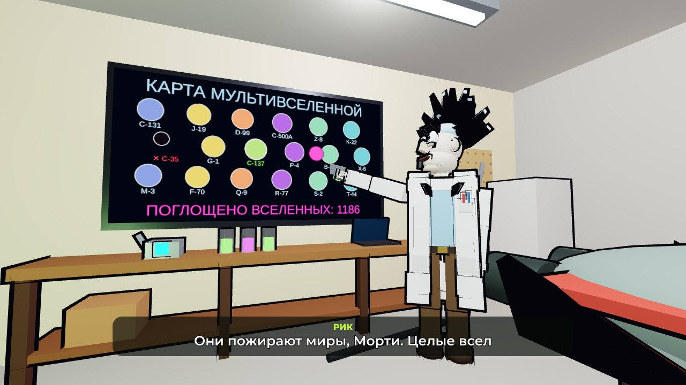
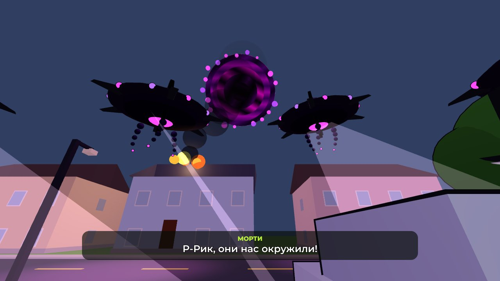
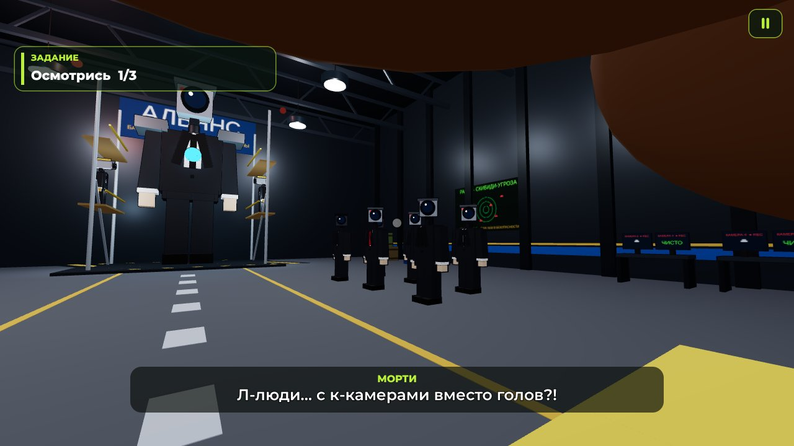

# Рик и Морти: главы 1–2 (Roblox)

Сюжетная фан-игра по «Рику и Морти» для нас с друзьями. Вид от первого лица, стиль «мульт + свет»:
цвета и чёрные контуры как в сериале, настоящие тени и солнечные лучи из окон.

Вся игра — файл места `RickMorty.rbxlx`. Код лежит в `src/`, файл собирается командой `python3 build.py`.

В меню:
- **Играть** — история с самого начала (глава 1, а за ней сразу глава 2);
- **Главы** — выбрать главу (можно начать сразу со второй).

> Картинки в `assets/preview/` нарисованы песочницей разработчика (three.js), а не Roblox Studio.
> В Roblox будет очень похоже, но вихрь портала, свет и шрифты выглядят немного иначе.

## Что есть в главе 1
1. **Главное меню «Портал».** Ночная комната Морти: Морти спит, посреди комнаты крутится зелёный портал.
   Кнопки **Играть**, **Настройки**, **Об игре**. Нажмёшь «Играть» — камера влетит в портал.
2. **Пробуждение от первого лица.** Чёрный экран, «Понедельник. 7:30», пищит будильник.
   Морти моргает и просыпается, думает «Ммм… уже утро?». Нажми **Пробел** — Морти садится и встаёт с кровати.
3. **Будильник.** Подойди к тумбочке и выключи его (**E**).
4. **Дорога на кухню.** Комната Морти на втором этаже, кухня на первом. Можно осмотреть дом:
   - постеры и компьютер;
   - семейное фото в коридоре;
   - ванную;
   - запертые двери Саммер, родителей и гаража (из-под двери гаража светит зелёным и что-то гудит).
   Если долго не найдёшь кухню, появится подсказка и маркер.
5. **Завтрак.** На холодильнике записка от мамы. Сядь за стол, насыпь хлопья «Хрусти-О», налей молоко
   и съешь 5 ложек.
6. **Телефон.** Достань телефон (**F**):
   - экран блокировки и рабочий стол;
   - открывается ТикТок: танцующий кот;
   - листаешь дальше: ролик «Как открыть портал в гараже», он начинает лагать;
   - экран глючит и затягивается зелёным вихрем, потом «НЕТ СИГНАЛА»;
   - Морти думает: «Б-блин, ч-что за фигня с телефоном?!»
7. **Щупальца.** Экран снова оживает, из телефона вылезают щупальца и затягивают Морти внутрь.
8. **Пиксельный мир.** Морти смотрит на свои руки — они из пикселей: «Ч-что со мной?!»
   Дальше он один идёт по тёмному неоновому коридору (задание «Найди выход»), лампы мигают.
9. **Засада и Рик.** Из стен лезут пиксельные щупальца. Открывается портал, выходит Рик,
   отстреливает щупальца из портальной пушки и зовёт Морти в портал. Игрок сам бежит в портал.
10. Рик и Морти уходят в портал — и начинается глава 2.

## Что есть в главе 2 «Вторжение»
1. **Гараж-лаборатория.** Заставка «ГЛАВА 2 · ВТОРЖЕНИЕ». Морти вываливается из портала на пол гаража,
   следом выходит Рик. В гараже: космический корабль Рика, верстак, большой экран, бак с портальной жижей,
   полки с гаджетами, доска с формулами «НЕ ТРОГАТЬ, МОРТИ».
2. **Рассказ Рика.** Подойди к Рику у большого экрана. Рик показывает досье на Пожирателей:
   - они пожирают миры и целые вселенные — на карте мультивселенной они съедают их одну за другой;
   - они пролезли через телефон Морти, то есть добрались и до нас: «ОБНАРУЖЕНЫ В C-137».
3. **Взрыв.** На улице грохочет взрыв: лампы мигают, с потолка сыплется пыль, экран мигает «ТРЕВОГА!».
   Открой ворота гаража — красная кнопка справа от ворот (**E**). Ворота сворачиваются вверх.
4. **Улица.** Горит дом соседей. Небо резко темнеет, над городом открывается тёмный разлом.
   Из него один за другим вылетают корабли Пожирателей (тарелки с шипами, щупальцами и розовым глазом)
   и окружают Рика и Морти, наводят на них розовые прожекторы.
5. **Граната.** Корабль-лидер подлетает ближе и сбрасывает пищащую гранату. Рик стреляет порталом,
   хватает Морти и утаскивает его в портал — за спиной взрыв.
6. **База камераменов** (измерение туалетной войны, «50-я серия»). Огромный ангар Альянса: камерамены
   (вместо головы — камера наблюдения), спикермены (вместо головы — колонка), Титан-камерамен в строительных
   лесах, инженеры со сваркой, радар скибиди-угрозы. Задание **«Осмотрись»**: посмотри на камераменов,
   спикерменов и Титана — они поворачивают головы к Морти.
7. **Финал.** Все смотрят на Морти, Рик объясняет, кто это такие, и «КОНЕЦ ГЛАВЫ 2 / Продолжение следует…».

**Рик** стал качественнее: у модели настоящий «скелет» (туловище, голова, руки и ноги двигаются отдельно).
Он ходит, моргает, говорит (рот открывается), рыгает, поворачивает голову, целится и стреляет из
портальной пушки, тянет руку к Морти.

**Пауза** — клавиша **P** (или кнопка **II** справа сверху). В паузе есть настройки и выход в меню.

**Настройки:**
- громкость музыки и звуков;
- чувствительность мыши;
- поле зрения;
- покачивание камеры;
- контуры предметов;
- качество эффектов;
- размер субтитров;
- подсказки.

## Как открыть
1. Roblox Studio → **File → Open from File** → `RickMorty.rbxlx`.
2. Нажми **Play** (F5). Сначала загрузка, потом главное меню.
3. Для красивого света:
   - **File → Studio Settings → Rendering → Editor Quality Level** — поставь повыше;
   - в игре: **Esc → Settings → Graphics Quality** — 8–10.

### Играть с друзьями
1. **File → Publish to Roblox** — игра появится у тебя в профиле.
2. Чтобы друзья могли зайти: **Game Settings → Permissions** → сделай игру публичной (**Public**).
   Фан-игры по чужим мультикам Roblox может закрыть по жалобе правообладателя,
   поэтому лучше не рекламировать её широко, а просто кинуть ссылку друзьям.
3. Если в игре несколько человек, каждый проходит свою историю. Все игроки — Морти и не толкают друг друга.

## Звуки и музыка (3 файла)
Все звуки сделаны с нуля генератором `tools/gen_audio.py`, без чужих сэмплов:

| Файл | Что внутри |
|---|---|
| `assets/sounds/MusicMenu.ogg` | таинственная тема меню, бесшовная петля |
| `assets/sounds/MusicMorning.ogg` | утренняя лаунж-босса-нова (мелодия из браузерной версии), петля |
| `assets/sounds/SfxAtlas.ogg` | все короткие звуки подряд в одном файле |

В `SfxAtlas.ogg` (150 секунд) лежат: будильник, шаги, хлопья, молоко, хруст, ложка, телефон, песня из ТикТока,
глитч, вибрация, птицы, щупальца, затягивание в телефон, жуткий фон пиксельного коридора,
выстрел портальной пушки, пиксельный взрыв, «бурп» Рика и другие звуки. Игра включает нужный кусок файла (`Config.Sfx`).
Так понадобилось всего 3 загрузки: без подтверждения возраста Roblox разрешает загружать мало аудио в месяц.

Для главы 2 в атлас добавлены: взрыв, гул и пролёт кораблей, гул разлома в небе, грохот, писк гранаты,
мотор ворот, кнопка, сирена, фон лаборатории и базы, жужжание камер, бас колонок, тревожная музыка.
**Если ты уже загружал `SfxAtlas.ogg` раньше — загрузи новый файл и поменяй его ID** в `Config.Sounds`.
Музыку (`MusicMenu.ogg`, `MusicMorning.ogg`) загружать заново не нужно.

Как подключить:
1. Studio → **View → Asset Manager** → кнопка **Bulk Import** → выбери три файла из `assets/sounds`.
2. Нажми правой кнопкой на загруженный звук → **Copy Asset ID**.
3. Вставь цифры в `ReplicatedStorage → Shared → Config` (раздел `Config.Sounds`). Например:
   `MusicMenu = "1234567890",`.

Пока ID пустые, музыки и эффектов не будет. Двери, шаги и щелчки кнопок звучат и без загрузки:
это встроенные звуки Roblox.

## Управление
| Действие | Компьютер | Телефон |
|---|---|---|
| Ходить / бежать | WASD / Shift | джойстик |
| Смотреть | мышь | свайп по экрану |
| Действие (двери, предметы) | E | нажать на подсказку |
| Встать, есть, листать | кнопка на экране / E / Пробел | нажать на кнопку |
| Телефон | F | кнопка «Достать телефон» |
| Осмотреться (глава 2) | мышь — навести взгляд | свайп |
| Пауза | P | кнопка II |

## Где что менять
- **Тексты** (мысли Морти, задания, записка мамы) — `src/ReplicatedStorage/Shared/Config.lua`, раздел `Config.Text`.
- **ID звуков и куски атласа** — там же, `Config.Sounds` и `Config.Sfx`.
- **Настройки по умолчанию** — `Config.DefaultSettings`.
- **Дом:**
  - каркас (стены, окна, лестница, крыша) — `src/ServerScriptService/Server/House.lua`;
  - мебель — `Rooms.lua`;
  - двери — `Doors.lua`;
  - улица — `Exterior.lua`.
- **Гараж-лаборатория** — `src/ServerScriptService/Server/Garage.lua`.
- **Сюжет** — глава 1: `src/ReplicatedStorage/Client/Story.lua`, глава 2: `Chapter2.lua` там же.

После правок в `src/` пересобери файл: `python3 build.py`.

## Как устроен код
- **Сервер** (`ServerScriptService`):
  - строит дом Смитов: 2 этажа, 9 комнат и гараж-лабораторию Рика, около 1950 деталей;
  - строит улицу с соседями;
  - отвечает за двери (их состояние видят все игроки);
  - превращает каждого игрока в Морти: жёлтая футболка, синие штаны, волосы из деталей.
- **Клиент** (`ReplicatedStorage/Client`, запуск — `StarterPlayerScripts/Client`):
  - `App` — загрузка, меню, глава, пауза;
  - `Menu` — главное меню, настройки, пауза;
  - `Portal` — 3D-портал;
  - `Story` — сюжет;
  - `Cine` — камера сценок;
  - `Controls` — вид от первого лица, бег, покачивание, шаги;
  - `World` — свет, лучи солнца, лампы;
  - `Outline` — контуры;
  - `Hud` — задание, субтитры, кнопки;
  - `Prompts` — подсказки [E];
  - `Breakfast` — завтрак (полая миска, колечки хлопьев, сок);
  - `Phone` — телефон и ТикТок;
  - `Tentacles` — щупальца;
  - `PixelWorld` — пиксельный мир и пиксельные руки;
  - `Rick` — Рик с портальной пушкой (скелетная модель);
  - `Chapter2` — сюжет главы 2;
  - `Lab` — экран лаборатории, лампы и ворота гаража;
  - `Ships` — корабли Пожирателей и граната;
  - `Fx` — взрывы, дым и огонь, пыль;
  - `CameraBase` — база камераменов: ангар, камерамены, спикермены, Титан;
  - `Audio` — звук.

## Песочница разработчика (`tools/`)
Roblox Studio здесь нет, поэтому код проверяется так:
- `NODE_PATH=… sh tools/check.sh` — синтаксис всех Lua-файлов и «случайные» глобальные переменные (нужен `luaparse`).
- `python3 tools/run_mock.py` — запуск игры в моке Roblox (Lua 5.4 через `lupa`). Сценарий `tools/scenario.lua`
  проходит всю историю как игрок: меню → пробуждение → будильник → кухня → завтрак → телефон → щупальца →
  пиксельный мир → Рик → портал → гараж → рассказ Рика → ворота → улица → корабли → граната →
  база камераменов → «Осмотрись» → конец → меню → «Главы» → глава 2 → пауза → меню.
  В отчёте ошибки, подозрительные обращения к свойствам и снимки сцен (`/tmp/rr_snap`).
- `node tools/render/shot.js снимок.json картинка.jpg "" снимок.gui.json` — картинка сцены и интерфейса (three.js
  в Chromium). Шрифты для превью: `npm install @fontsource/nunito @fontsource/montserrat @fontsource/amatic-sc`,
  файлы `*-cyrillic-*` и `*-latin-*` положить в `tools/render/fonts`.
- `python3 tools/gen_audio.py` — заново сгенерировать звуки и музыку; `python3 tools/gen_audio.py sfx` — только звуки.

## Что дальше (идеи для главы 3)
- Что Рик и Морти будут делать на базе камераменов? Помогут Альянсу против скибиди-туалетов?
- Пожиратели могут добраться и до этого измерения.

Инструкция для продолжения разработки (в том числе для другого Claude) — в `CLAUDE.md`.

Пиши, что добавить, и продолжим!

---
Фан-проект. «Рик и Морти» принадлежит его правообладателям, игра не связана с Adult Swim.
