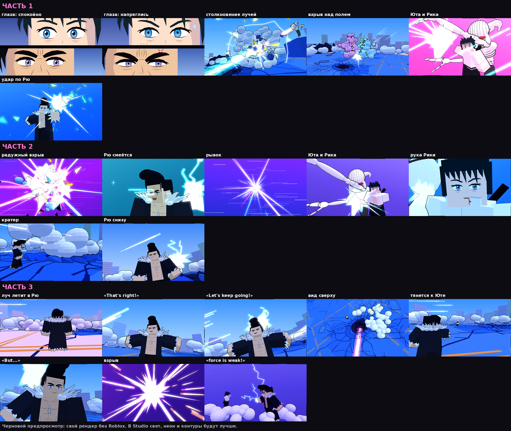

# Рю vs Юта — анимация в Roblox

Фан-анимация боя Рю Исигори и Юты Оккоцу из «Магической битвы».
Три части идут подряд одним роликом (11 + 15 + 16 ≈ 42 секунды) и повторяют присланные клипы по таймингу.

- **Рю и Юта** — блочные R6-персонажи Roblox в своей одежде:
  - Юта — белая куртка и чёрные штаны;
  - Рю — чёрный плащ с колючим мехом, голый торс и жетоны.
- **Лица** нарисованы ровными плоскими фигурами. В первом кадре Юта и Рю перед выстрелом напрягаются:
  - веки опускаются, брови сходятся;
  - зрачки сужаются, блики гаснут, радужки дрожат;
  - у Юты выступает капля пота, у Рю — вена.
- **Рика** собрана по картинке из вики:
  - голова-раковина и пасть с клыками;
  - волосы-щупальца, рёбра, длинные руки с когтями;
  - чёрный хвост.
- **Карта** сделана по кадрам аниме:
  - ярко-синий асфальт в трещинах;
  - оранжевая разметка, тёмный кратер, вздыбленные плиты;
  - персиковая пыль, белые облака дыма;
  - светлый город и голубое небо.
- **Эффекты** сделаны свои, без встроенных частиц Roblox и без кругов:
  - колючие аниме-вспышки из сужающихся лучей;
  - рваные ударные кольца;
  - искры-штрихи;
  - мультяшный дым с контуром;
  - языки пламени, блики-звёздочки, молнии;
  - энергия, бегущая по лучам;
  - обломки с контуром.

*Это черновой предпросмотр: его рисует мой собственный рендер, без Roblox. В Studio будут настоящие свет, неон и контуры.*

## Как запустить
1. Открой `RyuVsYuta.rbxlx` в Roblox Studio: **File → Open from File**.
2. Поставь графику на максимум:
   1. **File → Studio Settings → Rendering**.
   2. **Editor Quality Level** и **Graphics Mode** — самые высокие.
3. Нажми **Play** (F5).
4. Включи запись экрана: **Win+Alt+R** или OBS.
5. Нажми **ПРОБЕЛ** (или кнопку «Старт»): все три части пойдут подряд без остановок.
   - **1, 2, 3** — только одна часть.
   - **R** — повторить.

Скрипт можно вставить и в своё место: создай **LocalScript** в
`StarterPlayer → StarterPlayerScripts` и вставь в него весь код из `RyuVsYuta.client.lua`.

## Звук
Звук добавляешь сам в CapCut: тайминг совпадает с клипами. Если склеил три клипа подряд, звук тоже кладёшь подряд с начала записи.

## Кадры части 3
| Секунды | Что происходит |
|---|---|
| 0.00–2.40 | Рю спиной, на него летит розовый луч. |
| 2.40–4.00 | «That's right!»: Рю смеётся, раскинув руки. |
| 4.00–6.40 | «Let's keep going!»: смех, голубая энергия у головы, жёлтая молния. |
| 6.40–7.20 | Серый дым с розовой точкой, затем розовый луч сквозь обломки. |
| 7.20–7.75 | Юта бежит по асфальту. |
| 7.75–9.40 | Вид сверху: розовый луч бьёт в кратер. |
| 9.40–12.50 | Рю тянет руку к далёкому Юте, жёлтые молнии. |
| 12.50–13.90 | «But...»: ухмылка, голубое сияние. |
| 13.90–14.80 | Жёлто-розовый взрыв. |
| 14.80–15.97 | «its force is weak!»: с ладони Рю бьют молнии. |

Кадры частей 1 и 2 — как в клипах, их тайминг расписан в начале скрипта (`T1`, `T2`, `T3`).

## Настройки (`CONFIG` в начале скрипта)
| Настройка | Что делает |
|---|---|
| `PART = 0` | Какую часть повторяет R: 0 — все подряд, 1–3 — одну. |
| `AUTO_START = true` | Ролик стартует сам, без кнопки. |
| `DUMMY_MODE = true` | Рю и Юта становятся серыми манекенами без одежды. |
| `OUTLINES = false` | Убирает чёрный аниме-контур. |

## Файлы
- `src/` — код по частям:
  - ядро, треугольники;
  - скелет, лица, персонажи, Рика;
  - эффекты, карта, интерфейс;
  - кадры частей 1–3, запуск.
- `RyuVsYuta.client.lua` — готовый скрипт: всё из `src/` в одном файле.
- `RyuVsYuta.rbxlx` — готовое место для Studio.
- `build_place.py` — склеивает `src/` и собирает оба файла: `python3 build_place.py`.
- `preview.png` — черновая раскадровка.

Это фан-проект. «Магическая битва» принадлежит Гэгэ Акутами и её правообладателям.
